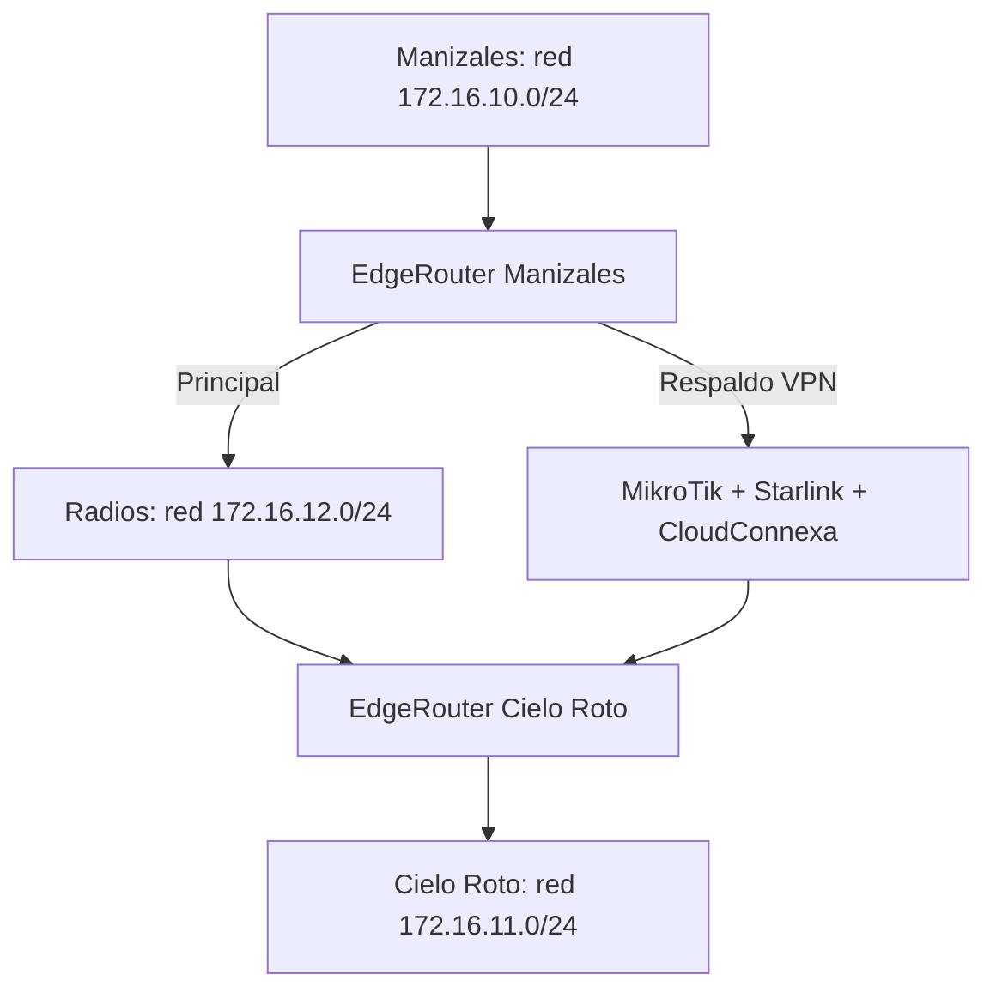

# Implementación de Starlink como respaldo de telemetría: Manizales – Cielo Roto

**Tipo:** documentación técnica y guía de verificación  
**Fecha de elaboración:** 6 de noviembre de 2026  
**Estado:** reconstrucción a partir de registros y salidas compartidas; no sustituye una copia de las configuraciones actuales.

## 1. Resumen ejecutivo

El proyecto buscó mantener la comunicación entre la sede de Manizales y la estación Cielo Roto usando la **red de radios como medio principal** y una **VPN sobre Starlink como respaldo**. Los EdgeRouter seleccionan el camino y los MikroTik proporcionan la conectividad a Internet y el túnel OpenVPN hacia CloudConnexa.

La implementación no debe confundirse con la de **El Desquite**, que es otro enlace. En particular, no se deben trasladar automáticamente a Cielo Roto las redes 172.16.47.0/24 y 172.16.48.0/24, ni las reglas o nombres de interfaz creados para Desquite.

**Alcance de la evidencia:** existen salidas que muestran una VPN de Manizales conectada, pruebas de radio, configuraciones de failover y una política de telemetría en Cielo Roto. No se dispone de una exportación completa y actualizada de los cuatro routers, de todos los servicios publicados en CloudConnexa ni de una prueba completa y documentada de reconexión de todas las aplicaciones durante un corte real. No se debe interpretar este documento como garantía del estado actual.

> **Precaución operativa:** este documento contiene direcciones internas y detalles de una red de telemetría. Compártelo solo con personal autorizado. Los ejemplos no son un script para pegar: la red tiene rutas y políticas existentes que podrían verse afectadas.

## 2. Objetivos

1. Mantener la comunicación de telemetría Manizales–Cielo Roto por radio cuando el enlace esté disponible.
2. Conectar ambos sitios a Internet mediante terminales Starlink administrados por un tercero.
3. Establecer un túnel VPN entre los MikroTik de ambos sitios utilizando CloudConnexa.
4. Enviar por el respaldo los flujos seleccionados cuando el enlace de radio no esté disponible.
5. Recuperar el camino principal al estabilizarse la comunicación por radio.
6. Permitir el diagnóstico y la gestión sin interferir con las redes de estaciones existentes.

## 3. Equipos y componentes

| Componente | Ubicación / función | Registro disponible |
|---|---|---|
| Starlink | Acceso a Internet en ambos extremos | Routers administrados por tercero; entregan IP privada. No se asumió acceso a su administración ni IP pública. |
| MikroTik hEX lite RB750r2 | Un equipo por sitio; acceso a Internet, cliente OpenVPN y enrutamiento | RouterOS 7.16.2 inicialmente; verificar versión real actual. |
| EdgeRouter X | Selección del camino de radio o respaldo; uno por sitio | EdgeOS v1.10.10 en registros compartidos. |
| CloudConnexa | Red VPN que interconecta los clientes de ambos sitios | Es necesario comprobar los conectores, IP Services y permisos actuales. |
| Enlace de radio | Conectividad primaria de telemetría | Red de tránsito 172.16.12.0/24 en el esquema registrado. |
| Servidor / core | Adquisición y enrutamiento en Manizales | LAN 172.16.10.0/24; core 172.16.10.1. |

## 4. Topología lógica



El bloque de VPN representa **dos MikroTik y dos conexiones a Internet**, unidos mediante CloudConnexa; no es un equipo físico intermedio único. La topología exacta de puertos y direcciones debe verificarse en cada equipo.

## 5. Direccionamiento y variantes observadas

### 5.1. Redes principales

| Elemento | Dirección o red | Estado de evidencia |
|---|---|---|
| LAN Manizales | 172.16.10.0/24 | Registrada. |
| Core Manizales | 172.16.10.1 | Registrado. |
| EdgeRouter Manizales, LAN | 172.16.10.220 | Registrado. |
| LAN Cielo Roto | 172.16.11.0/24 | Registrada. |
| EdgeRouter Cielo Roto, LAN | 172.16.11.1 | Registrado. |
| Tránsito radio | 172.16.12.0/24 | Registrado. |
| EdgeRouter Manizales, radio | 172.16.12.1 | Registrado. |
| EdgeRouter Cielo Roto, radio | 172.16.12.8 | Registrado en configuración posterior; también se mencionó .9 en una etapa anterior. Confirmar. |
| Cliente VPN MikroTik Manizales | 100.96.1.18 | Observado conectado en una captura histórica; verificar asignación actual. |

### 5.2. Dos variantes satelitales: no combinarlas sin revisión

Los registros contienen configuraciones diferentes que podrían corresponder a **etapas coexistentes o sucesivas**. No se puede reconstruir una transición completa ni afirmar cuál es la definitiva a la fecha del documento.

| Variante | Manizales | Cielo Roto | Evidencia |
|---|---|---|---|
| Canal satelital anterior `LB` | EdgeRouter `eth4` 172.16.14.1; MikroTik 172.16.14.3, según registros previos | EdgeRouter `eth4` 172.16.13.1; MikroTik 172.16.13.3 | Rutas estáticas y grupo `LB` hacia 172.16.13.3. No se demuestra que este camino sea el túnel VPN final. |
| Respaldo mediante VPN `TELEMETRIA` | Referencia histórica a EdgeRouter `eth2` 172.16.45.1 y MikroTik 172.16.45.3; **verificar** | EdgeRouter `eth3` y MikroTik 172.16.46.3; referencia a EdgeRouter 172.16.46.1 | Configuración textual de grupo y tablas en Cielo Roto; direcciones de Manizales proceden de registros anteriores incompletos. |

**No asumir que 172.16.13.3 y 172.16.46.3 son el mismo siguiente salto**, ni cambiar las rutas de uno por el otro sin revisar conexiones físicas, direcciones y uso de cada grupo. Los grupos `LB` y `TELEMETRIA` aparecen simultáneamente en una configuración observada.

## 6. Preparación y controles previos

Antes de intervenir equipos de producción:

1. Coordinar ventana de mantenimiento y disponer de un acceso local o alterno, especialmente si se administra por la red que se modificará.
2. Identificar los equipos por nombre, número de serie y direcciones; comprobar que corresponden a Cielo Roto y no a Desquite.
3. Guardar y descargar respaldos de configuración; controlar las credenciales y llaves como información sensible. Un export puede no incluir todos los secretos, certificados o claves privadas; comprobar el procedimiento de recuperación del equipo.
4. Documentar conexiones de cada puerto, alimentación y estado de radios y Starlink.
5. Tomar una línea base: rutas, estado de VPN y de failover, conectividad y adquisición real de datos.
6. Preparar una reversión específica, validada con la configuración que exista en ese momento. No eliminar rutas o reglas por coincidencias amplias de texto.

Consultas de inventario en MikroTik:

```routeros
/system identity print
/system resource print
/interface print
/ip address print
/ip route print
/ip dhcp-client print detail
/interface ovpn-client print detail
/ip firewall filter print detail
/ip firewall nat print detail
```

Consultas en EdgeRouter:

```text
show version
show interfaces
show ip route
show configuration commands | match "load-balance"
show configuration commands | match "protocols static"
show configuration commands | match "firewall modify"
show configuration commands | match "firewall in modify"
show load-balance status
show load-balance watchdog
```

Los resultados pueden contener información sensible: revisar antes de compartirlos.

## 7. Conexión a Starlink e Internet

La conexión prevista fue: **Starlink → puerto WAN del MikroTik → cliente VPN**. El puerto WAN recibió una dirección privada por DHCP; no se requirió configurar port forwarding en el router Starlink para que el cliente iniciara la conexión saliente.

En un registro de Manizales el cliente DHCP recibió `192.168.1.176/24` y se obtuvo respuesta a `1.1.1.1`; es una observación histórica, no una dirección fija garantizada. Verificar en cada extremo:

```routeros
/ip dhcp-client print detail
/ip address print
/ip route print where dst-address=0.0.0.0/0
/ping 1.1.1.1 count=4
```

Esperado: DHCP en estado `bound`, ruta por defecto activa hacia el gateway del acceso a Internet y respuesta al ping si la red permite ICMP. Si hay IP pero no salida, revisar el servicio Starlink, cableado, DHCP, gateway y la resolución DNS; un solo ping fallido no demuestra por sí solo que el servicio esté caído.

## 8. VPN OpenVPN mediante CloudConnexa

### 8.1. Diseño

Cada MikroTik actúa como **cliente** y se conecta hacia CloudConnexa usando Internet. El proveedor distribuye las rutas autorizadas y aplica las políticas de acceso entre redes. El tránsito de las redes privadas entre sedes requiere tanto rutas en la plataforma como rutas y permisos de ida y vuelta en los equipos locales.

En Manizales se observó:

| Parámetro | Valor registrado |
|---|---|
| Interfaz | `ovpn-Manizales` en un registro histórico; confirmar el nombre actual. |
| Estado | Conectado en la prueba histórica. |
| Dirección VPN | `100.96.1.18`. |
| Protocolo / puerto | UDP / 1194. |
| Servidor | `us-mia.gw.openvpn.com`. |
| Cifrado / autenticación | AES-256-CBC / SHA256. |
| Modo y MTU | IP / 1500 en el registro. |
| Certificado del servidor | Verificación habilitada. |

Los parámetros son una **fotografía histórica**, no instrucciones universales: usar el perfil vigente emitido para cada conector. No incluir en esta documentación archivos `.ovpn`, llaves privadas, contraseñas ni certificados privados.

### 8.2. Importación y comprobación

Se importó un perfil OpenVPN en el MikroTik; se registraron advertencias por las directivas no soportadas `setenv`, `socket-flags` y `push-peer-info`. Esas advertencias no impidieron la conexión observada, pero deben evaluarse en relación con el perfil real y la versión de RouterOS. La importación y su sintaxis pueden variar según la versión: comprobar las opciones disponibles en el equipo antes de efectuar cambios.

Consultas seguras:

```routeros
/interface ovpn-client print detail
/interface ovpn-client monitor [find where name="ovpn-Manizales"] once
/log print where topics~"ovpn"
/ip route print detail
```

Sustituir el nombre solo después de verlo en `print`; no usar selectores generales como `[find]` para habilitar o deshabilitar todos los clientes.

Una conexión `connected` demuestra el establecimiento del túnel, pero no demuestra que las subredes de telemetría estén enrutadas, autorizadas o accesibles en ambos sentidos.

### 8.3. Servicios y políticas en CloudConnexa

Para que el respaldo transporte telemetría hay que asociar a cada red los prefijos realmente situados detrás de su conector y permitir los flujos necesarios en los grupos de acceso. Como mínimo, identificar la red de Manizales `172.16.10.0/24` y las redes de Cielo Roto que realmente se desean alcanzar, por ejemplo `172.16.11.0/24`, siempre tras validar que no solapan con otros sitios.

No hay inventario completo de IP Services o Access Groups específicos de esta implementación. Por tanto, **no se puede afirmar qué prefijos exactos estaban publicados ni recomendar publicar redes completas sin comprobar el diseño**. Verificar rutas dinámicas recibidas en ambos MikroTik, acceso entre conectores, firewall y retorno. NAT y enrutamiento sin NAT son diseños distintos: no agregar masquerade de forma genérica porque oculta IP de origen y puede cambiar el funcionamiento de la adquisición.

## 9. Configuración observada en EdgeRouter Cielo Roto

### 9.1. Grupo `LB`: canal satelital 172.16.13.0/24

En la configuración compartida se observó:

```text
set load-balance group LB interface eth0 route table 1
set load-balance group LB interface eth0 route-test count failure 10
set load-balance group LB interface eth0 route-test count success 10
set load-balance group LB interface eth0 route-test interval 1
set load-balance group LB interface eth0 route-test type ping target 172.16.12.1
set load-balance group LB interface eth4 failover-only
set load-balance group LB interface eth4 route table 2
set load-balance group LB interface eth4 route-test type ping target 172.16.13.3
set protocols static table 1 route 0.0.0.0/0 next-hop 172.16.12.1
set protocols static table 2 route 0.0.0.0/0 next-hop 172.16.13.3
```

También se registraron pruebas de 10 fallos y 10 éxitos para `eth4`, intervalo de 1 segundo y retardo inicial de 10 segundos. El objetivo `172.16.13.3` comprueba el siguiente salto local; **no demuestra por sí solo que el destino remoto o la aplicación sean alcanzables**.

Las rutas principales registradas hacia Manizales incluían:

```text
set protocols static route 172.16.10.0/24 next-hop 172.16.12.1 distance 1
set protocols static route 172.16.10.0/24 next-hop 172.16.13.3 distance 10
```

Estas distancias expresan preferencia entre rutas instaladas, pero **por sí solas no garantizan detectar una caída remota** si el siguiente salto permanece disponible. Verificar cómo interactúan la tabla principal, las tablas de política, los probes y las reglas realmente aplicadas.

### 9.2. Grupo `TELEMETRIA`: respaldo VPN por 172.16.46.3

En una configuración posterior/alternativa compartida se observó el grupo `TELEMETRIA`, con radio en `eth0` y respaldo en `eth3`:

```text
set load-balance group TELEMETRIA interface eth0 route table 4
set load-balance group TELEMETRIA interface eth0 route-test count failure 10
set load-balance group TELEMETRIA interface eth0 route-test count success 10
set load-balance group TELEMETRIA interface eth0 route-test interval 1
set load-balance group TELEMETRIA interface eth0 route-test type ping target 172.16.12.1
set load-balance group TELEMETRIA interface eth3 failover-only
set load-balance group TELEMETRIA interface eth3 route table 3
set load-balance group TELEMETRIA interface eth3 route-test count failure 10
set load-balance group TELEMETRIA interface eth3 route-test count success 10
set load-balance group TELEMETRIA interface eth3 route-test interval 1
set load-balance group TELEMETRIA interface eth3 route-test type ping target 100.96.1.18
set load-balance group TELEMETRIA lb-local enable
set load-balance group TELEMETRIA lb-local-metric-change disable
set protocols static table 4 route 172.16.10.0/24 next-hop 172.16.12.1
set protocols static table 3 route 172.16.10.0/24 next-hop 172.16.46.3
set protocols static table 3 route 100.96.1.18/32 next-hop 172.16.46.3
set protocols static route 100.96.1.18/32 next-hop 172.16.46.3
```

Se observó además `initial-delay 10` para ambas interfaces. El destino `100.96.1.18` era la IP VPN histórica del MikroTik de Manizales. La ruta específica del probe busca mantener su alcance por el camino de respaldo; es necesario **verificar que la sonda no pueda regresar o alcanzar el destino por el propio radio**, pues produciría un estado falso de salud.

Con intervalo de 1 s y umbrales de 10, la intención es exigir varias pruebas consecutivas antes de marcar fallo o recuperación; el tiempo real puede variar. No interpretar los contadores como garantía de que todas las sesiones de aplicación hayan conmutado.

### 9.3. Política de enrutamiento `MDF`

Se observó en Cielo Roto:

```text
set interfaces switch switch0 firewall in modify MDF
set firewall modify MDF rule 5 action modify
set firewall modify MDF rule 5 description 'Prueba retorno LAN por VPN Starlink'
set firewall modify MDF rule 5 destination address 172.16.10.0/24
set firewall modify MDF rule 5 modify lb-group TELEMETRIA
set firewall modify MDF rule 10 action modify
set firewall modify MDF rule 10 destination address 172.16.10.0/24
set firewall modify MDF rule 10 modify lb-group LB
```

Ambas reglas tienen el mismo destino y no se mostraron otras condiciones. Como la regla 5 es anterior, la 10 podría no recibir el tráfico que coincida con la 5; comprobar reglas completas, contadores y funcionamiento específico de EdgeOS. La política se aplica al tráfico **entrante por `switch0`**: no implica que cualquier paquete originado por el propio EdgeRouter o entrante por otra interfaz utilice esa misma regla. `lb-local enable` es un ajuste separado que exige verificación.

Estado observado en una muestra: `TELEMETRIA` mostraba `eth0 active`, `eth3 failover` y ambos carriers arriba. En otra muestra de `LB`, `eth0` aparecía inactivo y `eth4` activo. Son observaciones en momentos/configuraciones diferentes, no evidencia de operación simultánea ni permanente.

## 10. EdgeRouter de Manizales y retorno

El EdgeRouter de Manizales fue identificado con LAN `172.16.10.220` y tránsito radio `172.16.12.1`. En registros históricos se mencionó su puerto `eth3` para radio y una ruta principal hacia `172.16.11.0/24` por `172.16.12.8`, con un segundo camino a través del enlace satelital. Otro registro menciona una distancia de respaldo 12 por `172.16.14.3`.

Para la variante VPN posterior se mencionó un enlace local `172.16.45.1` ↔ `172.16.45.3`, pero **no se dispone de la configuración completa de políticas, tablas, grupos y NAT del EdgeRouter de Manizales para esa variante**. Antes de reproducirla se debe inspeccionar:

```text
show interfaces
show ip route
show configuration commands | match "172.16.11"
show configuration commands | match "load-balance"
show configuration commands | match "firewall modify"
show configuration commands | match "protocols static table"
```

El core y los hosts deben enviar las redes de destino hacia el router correcto; el otro extremo debe tener retorno para las IP de origen. Revisar prefijos más específicos, reglas de PBR, rutas existentes, conectividad de los siguientes saltos y reglas de seguridad **antes** de modificar el core. No sustituir rutas de otras estaciones con rutas agregadas sin confirmar su alcance.

## 11. Secuencia de implementación reconstruida

La siguiente secuencia resume el trabajo documentado y los controles necesarios; **no todos los pasos tienen registro de ejecución completo**.

1. **Inventario de la red:** identificar LAN, radios, EdgeRouters, MikroTik, puertos y rutas preexistentes.
2. **Habilitación del acceso a Internet:** conectar cada MikroTik a su Starlink, comprobar DHCP y ruta por defecto, y probar salida.
3. **Conexión VPN:** generar un perfil para cada conector, cargarlo de forma segura, importar según la versión de RouterOS, activar el cliente específico y comprobar que queda conectado.
4. **Publicación de redes:** identificar prefijos de cada sitio y configurar los servicios y accesos necesarios en CloudConnexa; verificar que los prefijos no colisionan y que las rutas se reciben.
5. **Conexión MikroTik–EdgeRouter:** asignar las direcciones de tránsito previstas y probar cada vecino. Registrar qué variante se utiliza realmente (`13/14` o `45/46`).
6. **Failover en EdgeRouter:** revisar grupos existentes, sondas, tablas, distancias y política aplicada a cada interfaz; validar ambos sentidos. La existencia de un grupo sin una política aplicable no garantiza que seleccione tráfico de estaciones.
7. **Firewall y retorno:** validar tráfico desde la LAN, retorno hacia las IP de origen y acceso a puertos de aplicación. Decidir explícitamente si se utiliza NAT; no duplicar reglas.
8. **Prueba en producción controlada:** validar radio, simular una caída autorizada, verificar VPN y aplicación, restablecer radio y comprobar retorno. No hay evidencia suficiente para afirmar que cada una de estas pruebas se completó para todas las estaciones.
9. **Cierre:** documentar resultados y guardar configuraciones solo después de comprobar el comportamiento y tener una vía de recuperación.

## 12. Pruebas operativas recomendadas

### 12.1. Línea base con radio

Desde Manizales, probar un destino confirmado de Cielo Roto, por ejemplo el EdgeRouter `172.16.11.1` si sigue vigente:

```bash
ip route get 172.16.11.1
ping -c 5 172.16.11.1
```

Hubo una observación histórica de ping exitoso al EdgeRouter Cielo Roto con latencia aproximada de 11–12 ms; el usuario también informó que la telemetría estaba funcionando por radio. La latencia sola no prueba la ruta usada: correlacionar con tablas, contadores y estado del grupo.

En ambos EdgeRouter:

```text
show load-balance status
show load-balance watchdog
show ip route
```

En Cielo Roto revisar además:

```text
show ip route table 3
show ip route table 4
show firewall modify MDF statistics
```

La disponibilidad y sintaxis pueden variar por versión. Observar si los contadores cambian durante una prueba desde una fuente que realmente coincida con la política.

### 12.2. Validación del respaldo

Con ventana autorizada, acceso alterno y personal disponible, simular una caída **de un solo enlace previamente identificado**. Antes de hacerlo, verificar que la VPN y su retorno funcionan sin depender de radio; una prueba remota mal elegida puede dejar la estación sin acceso.

1. Confirmar que la sonda primaria marca fallo y que el grupo esperado selecciona `failover-only`.
2. Verificar por dónde circula un flujo nuevo de telemetría, no solo el estado del grupo.
3. Probar ping, una conexión nueva al puerto de la aplicación y recepción real de datos en el sistema de adquisición.
4. Anotar pérdida de paquetes, tiempo de detección, recuperación y latencia.
5. Restablecer la radio, verificar que la sonda se recupera y que los **flujos nuevos** usan la ruta principal.
6. Revisar si las sesiones TCP existentes se reconectan; algunas pueden interrumpirse por cambio de ruta o NAT. No vaciar indiscriminadamente la tabla de conexiones en producción.

### 12.3. Plantilla de resultados

| Prueba | Origen → destino | Estado esperado | Resultado / fecha |
|---|---|---|---|
| Radio normal | Servidor → estación identificada | Tráfico de telemetría por radio | Pendiente de registrar. |
| VPN conectada | MikroTik ↔ CloudConnexa | Clientes conectados y rutas esperadas | Pendiente de registrar. |
| Respaldo | Servidor → estación identificada | Flujo nuevo y datos por VPN | Pendiente de registrar. |
| Recuperación | Servidor → estación identificada | Retorno de flujos nuevos a radio | Pendiente de registrar. |
| Aplicación | NAM/servidor → equipo y puerto verificados | Adquisición y datos estables | Pendiente de registrar. |

## 13. Diagnóstico de fallas

| Síntoma | Comprobar primero | Observación |
|---|---|---|
| VPN desconectada | DHCP, gateway, Internet, DNS, hora, log OpenVPN, certificado y perfil | No publicar credenciales al compartir logs. |
| VPN conectada pero no hay acceso a LAN remota | Prefijos publicados, rutas recibidas, Access Groups, forward, retorno y NAT | Túnel conectado no equivale a ruta extremo a extremo funcional. |
| Ping responde pero web o adquisición no | Conexión TCP al puerto real, captura de paquetes, reglas forward, rutas asimétricas, MTU/MSS y aplicación | No abrir puertos indiscriminadamente; confirmar primero dónde se pierde el tráfico. |
| Radio caída pero no conmuta | Probe, umbrales, aplicación de `MDF`, tablas y next hop | Un gateway local vivo puede ocultar una caída más allá del gateway. |
| Respaldo activo pero sin datos | Ruta de ida y vuelta, políticas, SNAT, conexión a estación, servicio y contadores | Verificar ambos extremos; no basta con ver `active`. |
| No vuelve al radio | Probe de recuperación y rutas reales, conteo de éxitos y sesiones persistentes | Probar conexiones nuevas y confirmar estabilidad de radio. |
| No hay acceso web/SSH al MikroTik | `/ip service`, listas de interfaces, reglas `input` y ruta de retorno | `input` protege al router; `forward` controla tráfico atravesándolo. Restringir gestión a orígenes confiables. |
| Latencia o cortes variables | Calidad radio, Internet/Starlink, VPN, CPU, pérdida y MTU | Comparar las dos rutas con mediciones simultáneas, no solo un ping. |

## 14. Estado conocido y elementos pendientes

**Confirmado en registros históricos:**

- Se buscó y configuró prioridad de radio con respaldo satelital.
- La VPN de Manizales llegó a estar conectada con dirección `100.96.1.18`.
- Se registró en Cielo Roto el grupo `TELEMETRIA` con radio `eth0`, respaldo `eth3`, tablas 4 y 3 y política `MDF` sobre `switch0`.
- El usuario reportó pings funcionando y telemetría por radio en una fase previa.

**Pendiente de confirmar con inventario actual:**

- Identidades, versiones, puertos y cableado exactos de los cuatro equipos.
- Cuál de las variantes `13/14` y `45/46` está operativa y el papel de cada grupo.
- Export completo del EdgeRouter Manizales, direccionamiento y rutas del MikroTik de Cielo Roto.
- Servicios, prefijos, conectores, políticas y rutas actuales en CloudConnexa.
- Reglas NAT y firewall efectivamente utilizadas por cada flujo de telemetría.
- Prueba completa de falla y recuperación para las aplicaciones y estaciones involucradas.
- Configuración guardada y posibilidad de recuperación desde respaldo.

## 15. Referencia de procedencia

Documento reconstruido a partir de los datos facilitados en las conversaciones del proyecto, incluyendo salidas de RouterOS y EdgeOS, y resúmenes de antecedentes del enlace Manizales–Cielo Roto. Algunas direcciones o resultados proceden de registros resumidos; se identificaron explícitamente las variantes y las incertidumbres para evitar tratarlas como una exportación íntegra. No se utilizó como evidencia la configuración de la implementación distinta de El Desquite.

